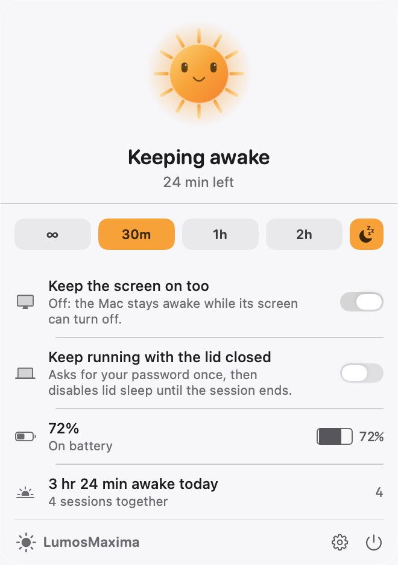
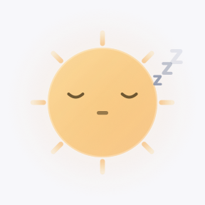

<div align="center">


# LumosMaxima

**A sun that keeps your Mac awake, and grows every hour it does.**

  

[Install](#install) · [Features](#features) · [The pet](#the-pet) · [Lid sleep](#lid-sleep) · [Development](#development)

English · [简体中文](README.zh-CN.md)

<br>



</div>

## Features

**One click, no sleep.** Pick 30 minutes, 1 hour, 2 hours, or until you stop it — the default, and the one pick that starts the session even from asleep, so it is always one click. A kernel power assertion holds the Mac awake; it disappears on its own if the app crashes, so nothing can leave it stuck on.

**Choose what stays on.** Keep the screen on too, or let it turn off while the Mac keeps working.

**The lid, without the guesswork.** Turn on *Keep running with the lid closed* and LumosMaxima installs a tiny root helper once, with a single administrator prompt. After that the switch is instant and password-free, and quitting the app puts your normal sleep setting back.

**Battery guard.** On battery at the percentage you choose — 20% by default — the session ends itself and tells you why.

**A pet worth keeping awake for.** The sun naps with floating Zs when the Mac may sleep, and wakes up, breathes, spins its rays and blinks when it may not. It grows from a spark to an ember, a flare, a sun and finally a supernova as it logs hours, all tracked per calendar day. Drag it anywhere. A single click opens a small strip with the four lengths and a close button; a double click opens Settings.

**Notification when time is up**, and open at login.

**Cheap when idle.** The pet is a single `Canvas` drawing at 6 frames per second while awake and 3 while it naps; with the pet hidden the app costs about 0.1% of a CPU core.

**English and Chinese.** The app follows the system language. To pick another language for LumosMaxima only, use System Settings → General → Language & Region → Applications.

## The pet

<p align="center">
  
  
</p>

| Stage | After | The sun |
| --- | --- | --- |
| Spark | 0 h | Small, with short rays. |
| Ember | 1 h | Warmer and a little larger. |
| Flare | 3 h | A full ring of rays. |
| Sol | 6 h | Deep orange, at its widest. |
| Nova | 10 h | Brightest, with the longest rays. |

Awake time is counted per calendar day: the pet starts each day at whatever stage that day's hours have earned. Settings → Your sun shows the stage list and can start the pet over.

## The menu bar


The icon is an SF Symbol, so the menu bar tints it exactly like the system's own: `sun.min` while the Mac may sleep, `sun.max` while it is kept awake but the screen may turn off, and `sun.max.fill` while the screen stays on too. With *Show the time left in the menu bar* on, the countdown sits next to it.

The left click opens the panel; a right click opens a menu with the same switches. <kbd>⌃</kbd><kbd>⌥</kbd><kbd>⌘</kbd><kbd>L</kbd> starts or stops from anywhere.

## Install

```sh
git clone https://github.com/zchan0/LumosMaxima.git
cd LumosMaxima
scripts/package.sh --install
```

This builds a release app, signs it with a local Apple Development identity when one exists, and copies it to `/Applications`. There is no notarized download yet.

## Lid sleep

A closed lid sleeps a Mac no matter what power assertions it holds. The only way around it is `pmset -a disablesleep 1`, which needs root and stays in effect until it is set back — a crashed app would leave your Mac unable to sleep.

So the first time you turn the switch on, LumosMaxima asks for an administrator password and installs one small helper:

- `/Library/PrivilegedHelperTools/LumosMaximaLid.sh` — sets `disablesleep` to match a flag file, and puts it back if LumosMaxima is not running.
- `/Library/LaunchDaemons/io.github.zchan0.LumosMaxima.lid.plist` — runs that script at boot, every minute, and whenever the flag changes.

The app never runs as root and never asks twice. Uninstalling the helper takes one command:

```sh
sudo launchctl bootout system/io.github.zchan0.LumosMaxima.lid
sudo rm -f /Library/PrivilegedHelperTools/LumosMaximaLid.sh \
  /Library/LaunchDaemons/io.github.zchan0.LumosMaxima.lid.plist
sudo pmset -a disablesleep 0
```

## Development

```sh
swift build            # build
swift test             # unit tests (Swift Testing)
scripts/package.sh     # .build/app/LumosMaxima.app
scripts/readme-assets.sh   # regenerate docs/images
```

The layout follows the other small menu bar apps in this folder: a SwiftPM executable target, AppKit for the status item and windows, SwiftUI for everything inside them, and one observable model (`AppModel`) that owns the session and its side effects.

| File | What it does |
| --- | --- |
| `SessionEngine.swift` | Holds the power assertion, counts down, reports how a session ended. |
| `SleepAssertion.swift` | The IOKit assertion: `PreventUserIdleSystemSleep`, plus the display one when asked. |
| `LidControl.swift` | The helper install, the flag file, and reading `pmset`. |
| `Battery.swift` | Battery level, charging state, and the low-battery rule. |
| `SunStage.swift` | The pet's growth thresholds, pure and unit-tested. |
| `PanelView.swift`, `SunPetView.swift` | The panel and the pet, all drawn in SwiftUI. |
| `AppDelegate.swift` | Launch, the one-second tick, quitting cleanly. |

Debug builds understand a few environment variables for screenshots, which is how `docs/images` is made: `LUMOS_SNAPSHOT`, `LUMOS_PANEL_STATE=asleep`, `LUMOS_STATUS_SNAPSHOT`, `LUMOS_PET_SNAPSHOT`, `LUMOS_PET_STATE`, `LUMOS_APPEARANCE`, `LUMOS_AUTO_START`, `LUMOS_OPEN_PANEL`, `LUMOS_PANEL_CAPTURE`.

## Notes

- Without a battery, the battery row and the low-battery rule simply do nothing.
- *Reduce Motion* turns the pet's breathing, spinning and blinking off; it keeps its expression.
- The app never takes focus: the panel and the pet are non-activating, so a click does not interrupt typing.
