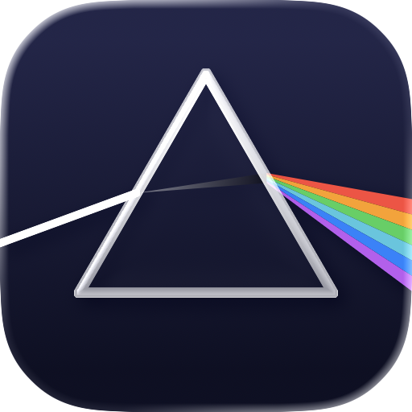
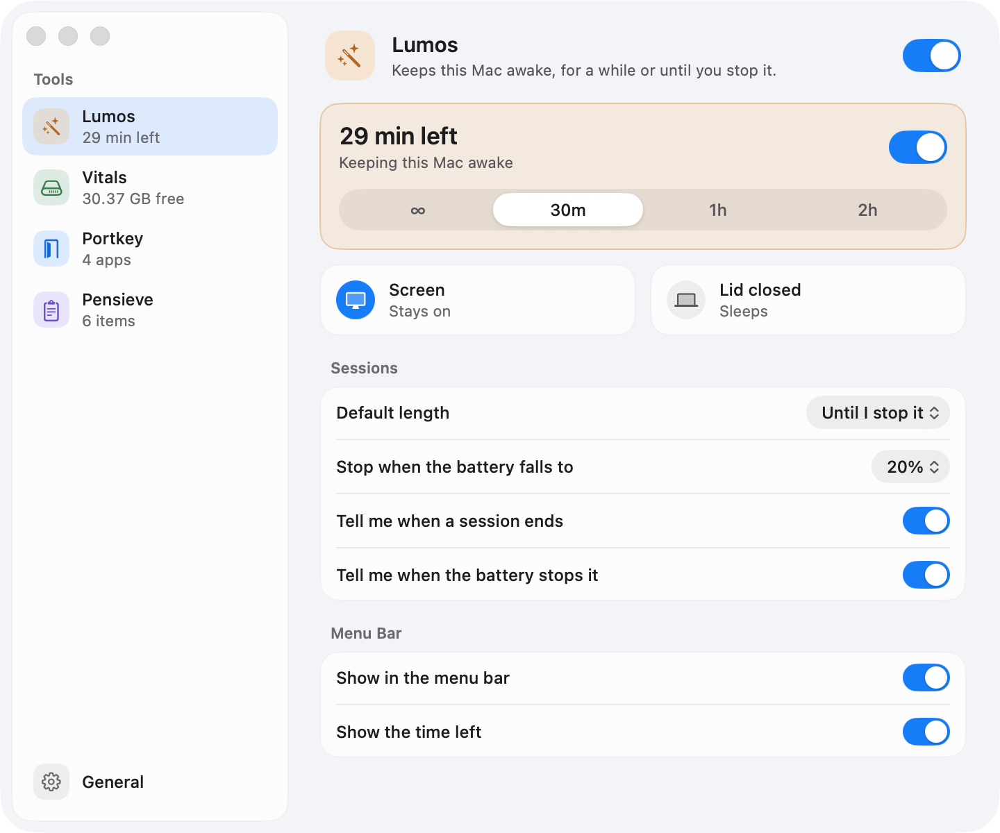
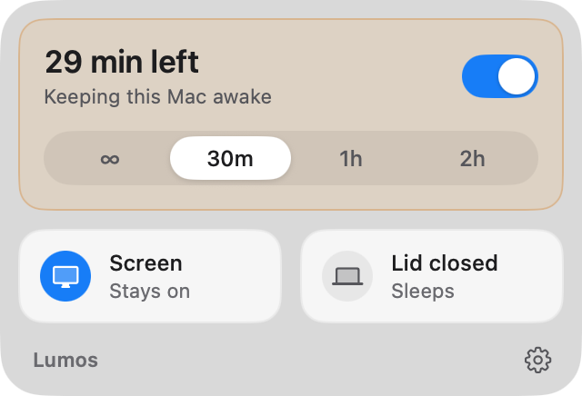
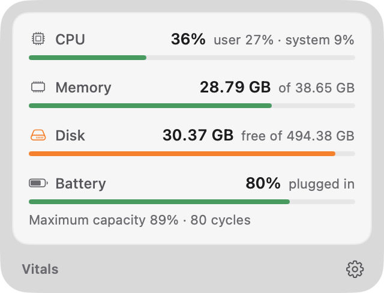
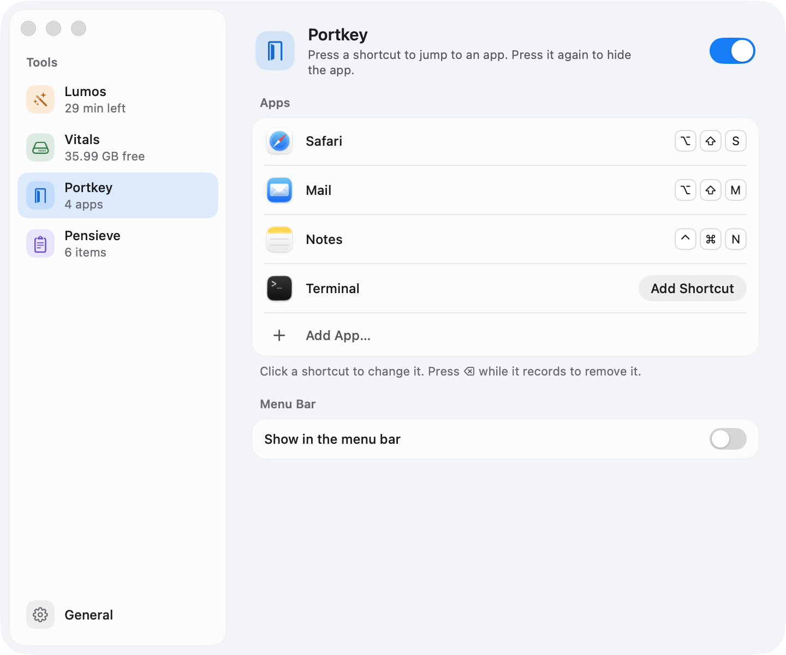
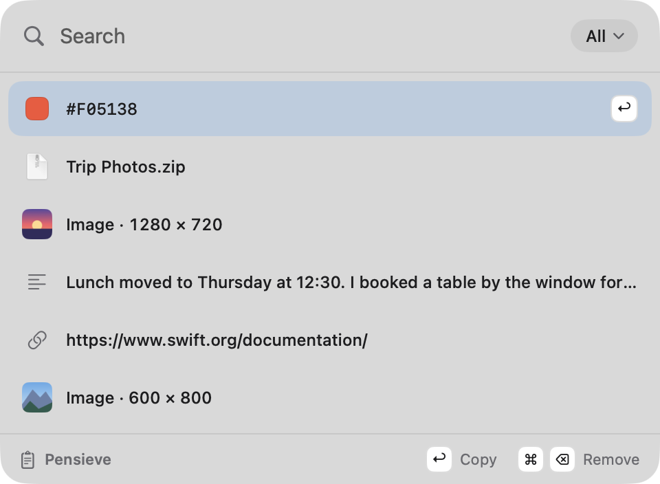
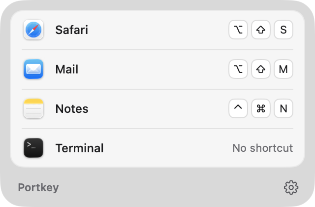
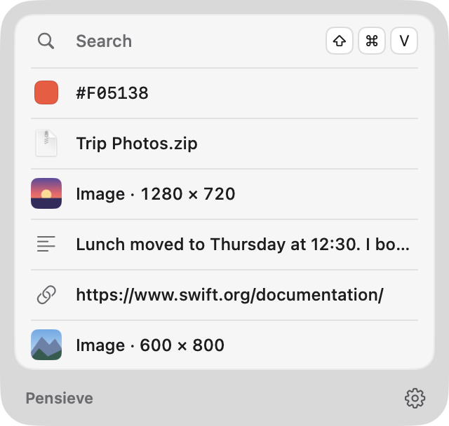

<div align="center">



# Prism

**A small toolbox in the menu bar: keep your Mac awake, and keep an eye on it.**

   

[Download](https://github.com/zchan0/Prism/releases/latest) · [Install](#install) · [Tools](#tools) · [Menu bar and panels](#menu-bar-and-panels) · [Lid sleep](#lid-sleep) · [Development](#development)

English · [简体中文](README.zh-CN.md)

<br>



</div>

Prism holds a few small tools. You can turn each tool on or off, and give each one its own menu bar icon or keep it only in the Prism window. Today there are four tools: **Lumos** keeps the Mac awake, **Vitals** shows how it is doing, **Portkey** gives each of your apps a shortcut, and **Pensieve** keeps what you copy. Portkey's name comes from the portkeys of Harry Potter, objects that take you somewhere else at a touch: press an app's shortcut, and you are in that app. Pensieve's comes from the stone basin in the same books that keeps memories to look at again.

## Tools

<p align="center">
  
  
</p>

### Lumos

**One click, no sleep.** Turn on the switch on Lumos's card to keep the Mac awake for the default length, which is until you stop it. Or pick ∞, 30m, 1h or 2h under it: a length starts a session at once, or restarts the one that is running, so it is always one click. The card turns amber and counts down while the Mac is kept awake. A kernel power assertion holds the Mac awake. The assertion goes away on its own if the app crashes, so nothing can leave the Mac stuck awake.

**Choose what stays on.** Click *Screen* to keep the screen on too, or to let it turn off while the Mac keeps working.

**The lid, without the guesswork.** Click *Lid closed* to keep running with the lid closed, and Prism installs a tiny root helper once, with one administrator prompt. After that the change is instant and asks for no password, and your normal sleep setting comes back when the session ends. See [Lid sleep](#lid-sleep).

**Battery guard.** On battery, the session ends itself at the percentage you choose, 20% by default, and tells you why. While the Mac runs on battery, a card under the Screen and Lid closed buttons says so: "Stops at 20% battery". Errors, such as a lid change that did not take, show in the same card.

**Notifications** when the time is up or the battery ends the session, and the time left in the menu bar if you want it. The default length, the battery level and the notifications are on Lumos's page in the Prism window.

### Vitals

**CPU, memory, disk and battery in one place.** The panel shows every reading with a bar:

- CPU: the average load since the last refresh, split into user and system time.
- Memory: used memory (active, wired and compressed), of the total.
- Disk: available space, with the space macOS can reclaim, the same number Finder shows.
- Battery: the charge and the power source, plus the maximum capacity and the cycle count.

**An icon for each reading you pick.** Turn on the readings you want in the menu bar. Each one gets its own icon, so you can ⌘-drag each one to its own place. Disk is on by default, and at least one stays on. Choose whether the numbers sit next to the icons. Every reading refreshes every 20 seconds and whenever the panel opens.

### Portkey

<p align="center">
  
</p>

**One shortcut for each app.** Add the apps you use most, and record a shortcut for each one. Press it to bring the app to the front. If the app is not running, Portkey opens it. If the app is in front already, the same shortcut hides it.

**Record the keys you want.** On Portkey's page in the Prism window, click an app's shortcut, or *Add Shortcut*, and press the keys, such as ⌥⇧C or ⌃⌘F5. A shortcut needs ⌘, ⌃ or ⌥. Press Esc to stop recording, or Delete to clear the shortcut. A shortcut belongs to one app at a time: if another app has it already, or macOS refuses it, the page says so under the app, and the app keeps its old shortcut.

**Go to an app from the panel, too.** Portkey's panel lists every app with its shortcut. Click one to do what its shortcut does.

**Add apps from anywhere.** *Add App…* at the end of the list shows the apps that are open and the apps in the Dock, and *Other…* picks any app in Applications. Hover over an app to remove it. A new app has no shortcut until you record one. Portkey has no menu bar icon by default, and its shortcuts work without one. To give it an icon, turn on *Show in the menu bar*.

**A shortcut stays on its key.** Portkey remembers the key you pressed, not the letter on it. If you switch to another keyboard layout later, the shortcut stays on the same key and keeps the name it had when you recorded it.

**No permission needed.** Portkey uses the system's hot key API, `RegisterEventHotKey`, so it needs no Accessibility permission. Recording reads only the keys you type into the Prism window.

### Pensieve

<p align="center">
  
</p>

**What you copied, in one list.** Pensieve keeps the last 200 things you copied: text, pictures, files and colors. If you copy the same thing again, it moves to the top instead of showing up twice. *Keep* on Pensieve's page sets how many it keeps, from 50 to 1000; a lower number deletes the oldest items at once.

**Old items go on their own.** An item is deleted a month after you last copied it, or picked it from the list. *Clear after* on Pensieve's page makes that a day, a week or three months, or never. Pensieve checks when it starts and every hour.

**Open it from any app.** Press ⇧⌘V, or click *Search* in Pensieve's panel. The list opens in the middle of the screen with the pointer, and the app you were in stays in front. Type to search text, file names and colors. The filter at the right of the search field shows all items, or only text, links, pictures or files; Tab and ⇧Tab go through the filters, and the list starts at All each time it opens. Text includes colors and links. Press ↑ and ↓ to pick an item and Return to put it back on the clipboard, then press ⌘V to paste it. Pensieve never pastes for you. Press ⌘⌫ to remove an item, Esc to close the list, and ⌘, to open Pensieve's page in the Prism window.

**See a picture up close.** When a picture is selected, a larger copy of it, with its size in pixels, appears next to the list. In the panel, rest the pointer on a picture for a moment.

**Or pick from the panel.** Pensieve's panel shows the latest 10 items. Click one to put it back on the clipboard; the panel says *Copied* and closes.

**Pick your own shortcut.** On Pensieve's page in the Prism window, click the keys next to *Shortcut* and press new ones, as on Portkey's page. A shortcut needs ⌘, ⌃ or ⌥. Press Delete while recording to clear it; then the history opens only from the panel.

**What it keeps, and what it leaves out.** Pensieve keeps plain text, rich text, HTML, PNG and TIFF pictures, files and colors, and puts all of them back, so a paste keeps its formatting. It leaves out what an app marks as private, such as a password from a password manager, and what an app puts on the clipboard only for a moment or on its own. It also leaves out anything over 20 MB. While *Pause recording* is on, on Pensieve's page, it keeps nothing, and the panel offers *Resume*.

**Apps it does not listen to.** Under *Don't record from* on Pensieve's page, list the apps whose copies Pensieve should skip. It goes by the app in front when something is copied. Passwords and Keychain Access are on the list until you change it; add apps from the ones that are open, the ones in the Dock, or any other, as on Portkey's page.

**Your history stays on this Mac.** Pensieve saves it in `~/Library/Application Support/Prism/Pensieve/`, a folder that only your user can open. The files are not encrypted. *Clear…* next to *Clear history* on Pensieve's page deletes them all.

**No permission needed.** Any app can read the clipboard, and the shortcut uses `RegisterEventHotKey`, as Portkey's do. Pensieve never types or pastes for you, so it needs no Accessibility permission.

## Menu bar and panels


Every icon is an SF Symbol template with an optional number in monospaced digits, so the menu bar tints it like the system's own icons. Lumos shows a wand, `wand.and.stars`: a bare wand while the Mac may sleep, and the wand with its stars while it is kept awake. Each Vitals icon shows the symbol of its reading: `cpu`, `memorychip`, `internaldrive`, or a battery that empties with the charge.

Prism has no icon of its own. A tool's icon appears when its *Show in the menu bar* switch is on. When no tool is in the menu bar, a small Prism icon (`triangle`) appears instead, so the Prism window stays reachable.

<p align="center">
  
  
</p>

- **Click a tool's icon** to open its panel, with that tool alone. The tool's name and a gear sit at the bottom; the gear, or ⌘, while the panel is open, opens the tool's page in the Prism window.
- **Right-click a tool's icon** for *Prism Settings…*, which opens the tool's page in the Prism window, and *Quit Prism*.
- **Click the Prism icon**, when it shows, to open the Prism window on the page it showed last.
- **Open Prism again** from Finder, Spotlight or Launchpad while it runs, and the Prism window opens. It also opens by itself the first time Prism runs.

A panel closes when you click anywhere else, and it does not take focus, so a click on it does not interrupt your typing.

The Prism window is the whole toolbox. The list on the left has every tool, each with what it is doing now, and *General* at the bottom. A tool's page starts with its switch, the only place that turns the tool on or off. A tool that is turned off stops all its work and keeps its settings. Below the switch come the tool's controls, for Lumos and Vitals, then its settings, then a *Menu Bar* card with *Show in the menu bar* and the tool's own menu bar settings, such as which readings Vitals shows there. *General* has *Appearance*, which keeps Prism light or dark or lets it follow the system, *Open at login* and *Quit Prism*, then *About*: the version and its updates, and links to GitHub and the release notes. ⌘W closes the window.

## Install

1. Download `Prism-<version>.zip` from [Releases](https://github.com/zchan0/Prism/releases/latest), unzip it, and drag `Prism.app` into Applications.
2. Open the app. macOS says it cannot verify the developer, because Prism is not notarized by Apple: click Done.
3. Open System Settings → Privacy & Security. Near the bottom, find Prism, click Open Anyway, and confirm. After that, the app opens normally.

Instead of steps 2 and 3, you can run `xattr -dr com.apple.quarantine /Applications/Prism.app` once.

Prism updates itself. Once a day it asks GitHub for a newer version, downloads it, and installs it when Prism is idle, then opens again. In the Prism window, *General* → *About* changes how often it checks, or turns installing automatically off. A version from before this feature has to be replaced by hand once: quit Prism and replace `Prism.app` with the new one. If macOS blocks the new version, repeat steps 2 and 3.

This is the only thing Prism does on the network. It asks `api.github.com` for the latest release and downloads it from GitHub, and it sends nothing about you.

Prism needs macOS 14 or later, on Apple silicon or Intel.

To build it yourself instead, run `scripts/package.sh --install` in a clone of this repository. It builds a universal release app, signs it ad hoc, and copies it to `/Applications/Prism.app`.

## Lid sleep

A closed lid sleeps a Mac no matter what power assertions it holds. The only way around it is `pmset -a disablesleep 1`, which needs root and stays in effect until it is set back. A crashed app would leave your Mac unable to sleep.

So the first time you click *Lid closed*, Prism asks for an administrator password and installs one small helper:

- `/Library/PrivilegedHelperTools/io.github.zchan0.prism.LumosLid.sh` turns `disablesleep` on while Prism holds a flag file open, and off otherwise.
- `/Library/LaunchDaemons/io.github.zchan0.prism.LumosLid.plist` runs that script at boot, every minute, and whenever the flag changes.

The helper does not look for Prism by name. It asks the kernel whether any process still holds the flag open, and the kernel closes the file however Prism exits, crash included. So a crashed Prism gets its normal sleep setting back within a minute.

The app never runs as root. It asks for the password again only when a new version changes the helper. To uninstall the helper, run:

```sh
sudo launchctl bootout system/io.github.zchan0.prism.LumosLid
sudo rm -f /Library/PrivilegedHelperTools/io.github.zchan0.prism.LumosLid.sh \
  /Library/LaunchDaemons/io.github.zchan0.prism.LumosLid.plist
sudo rm -rf /var/tmp/io.github.zchan0.prism.LumosLid
sudo pmset -a disablesleep 0
```

## Development

```sh
swift build                    # build
swift test                     # unit tests (Swift Testing)
scripts/package.sh             # .build/app/Prism.app, universal and signed ad hoc
scripts/readme-assets.sh       # regenerate docs/images
scripts/dist.sh <version>      # test, package and zip into .build/dist, as a release does
scripts/release.sh <version>   # push the tag that publishes a release
```

Prism is a SwiftPM package. AppKit draws the status items, the panels and the windows, and SwiftUI draws everything inside them.

| Module | What it holds |
| --- | --- |
| `PrismKit` | The shell's parts: the `Tool` protocol, status items, the floating panel and the panel beside a window, the menu bar glyph, the palette and every shared part (cards, rows, switches, segmented controls, buttons, menus, keycaps, tiles, lists of apps), global shortcuts and the field that records them, per-tool settings. |
| `LumosTool` | The session engine and its power assertion, the lid helper, the battery guard, notifications. |
| `VitalsTool` | The CPU, memory, disk and battery readings. |
| `PortkeyTool` | The apps and their shortcuts, and the switch to an app: bring it to the front, open it, or hide it. |
| `PensieveTool` | The clipboard history: what it keeps, the files it saves, and the history window. |
| `Prism` | The app: it registers the tools and owns the menu bar items, the tools' panels and the Prism window. |

A tool depends only on `PrismKit`, never on another tool. To add one, write a module with a type that conforms to `Tool`, and add one line to `AppDelegate.registrations()`.

Debug builds read a few environment variables, which is how `docs/images` is made:

| Variable | What it does |
| --- | --- |
| `PRISM_CAPTURE=<dir>` | Screenshots each tool's panel (`popover-<tool>.png`), every page of the Prism window (`window-<tool>.png`, `window-general.png`), Lumos's panel and page with its battery note and an error (`popover-lumos-note.png`, `window-lumos-note.png`), the Pensieve window (`pensieve-window.png`), its filter menu open over the screen behind it (`pensieve-filter-menu.png`), the window with Images picked in that menu (`pensieve-window-images.png`) and the picture's preview (`pensieve-preview.png`) into the folder, then quits. The panels leave ⌘, to the app in front. Portkey shows sample apps instead of yours, and its shortcuts are off. Pensieve shows sample items instead of your history: it does not watch the clipboard, read or save the history, or set up its shortcut. |
| `PRISM_STATUS_CAPTURE=<file>` | Draws every menu bar icon on a light, a dark and a blue menu bar, then quits. Pensieve does not watch the clipboard, and Portkey's shortcuts are off. |
| `PRISM_CAPTURE_GENERAL=<file>` | Screenshots the Prism window on *General*, then quits. Lumos, Pensieve and Portkey leave your session, history and shortcuts alone, as with `PRISM_CAPTURE`. |
| `PRISM_SHOW_WHATS_NEW=1` | With `PRISM_CAPTURE_GENERAL`, opens *What's new* and screenshots the screen around the window instead. |
| `PRISM_START_LUMOS=1` or `lid` | Starts a 30 minute Lumos session at launch. `lid` also keeps the Mac awake with the lid closed, if the helper this build carries is installed; it never asks for a password. |
| `PRISM_UPDATE=1` | Lets a debug build update itself: it checks at launch, then on the schedule. |
| `PRISM_UPDATE_FEED=<url>` | Reads the latest release from this URL instead of GitHub, such as a local `latest.json` with the same fields. |
| `PRISM_UPDATE_INSTALL_NOW=<seconds>` | Installs a downloaded update that many seconds after launch at the earliest, as *Install and Relaunch* does, even while Lumos keeps the Mac awake. |
| `PRISM_UPDATE_PHASE=<name>` | Shows a made-up update state on *General*, without checking, downloading or saving anything: `idle`, `never`, `unchecked`, `checking`, `available`, `downloading`, `ready`, `readyBlocked`, `readyManual`, `installing`, `updated`, `checkFailed`, `downloadFailed`, `verifyFailed`, `installFailed`, `cannotInstall` or `unavailable`. |
| `PRISM_APPEARANCE=light` or `dark` | Forces the appearance, over the one picked on *General*. |
| `PRISM_DUMP=1` | Prints each tool's summary, then quits. |
| `PRISM_PORTKEY_SWITCH=<bundle id>` | Switches to that app 3 seconds after launch, as a Portkey shortcut does. |

### Releasing

1. Add a `## [X.Y.Z] - YYYY-MM-DD` section to `CHANGELOG.md`, and its link at the bottom. Commit it and push `main`.
2. Run `scripts/release.sh X.Y.Z`. It stops unless `main` is clean and pushed, the changelog has the section, and the tag `vX.Y.Z` is new. Then it tries the release locally with `scripts/dist.sh` and pushes the tag.
3. The tag starts the Release workflow in `.github/workflows/release.yml`. On a macOS 26 runner, the workflow tests and builds Prism, then publishes the zip, its SHA-256 and the changelog section as a GitHub release. `release.sh` waits for it and prints the link.

## Notes

- Without a battery, Vitals leaves the battery reading out, and the battery guard does nothing.
- The app follows the system language, English or Chinese. To pick a language for Prism only, use System Settings → General → Language & Region → Applications.

## License

[MIT](LICENSE)
