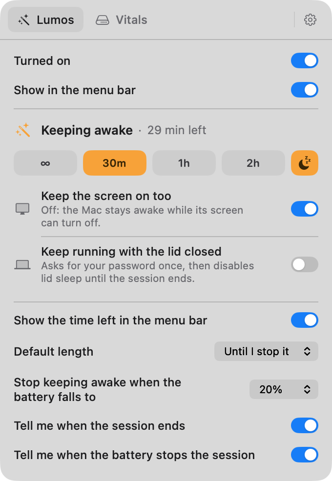
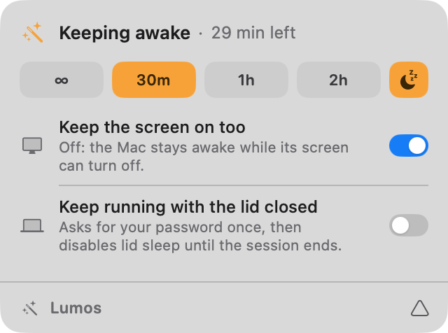
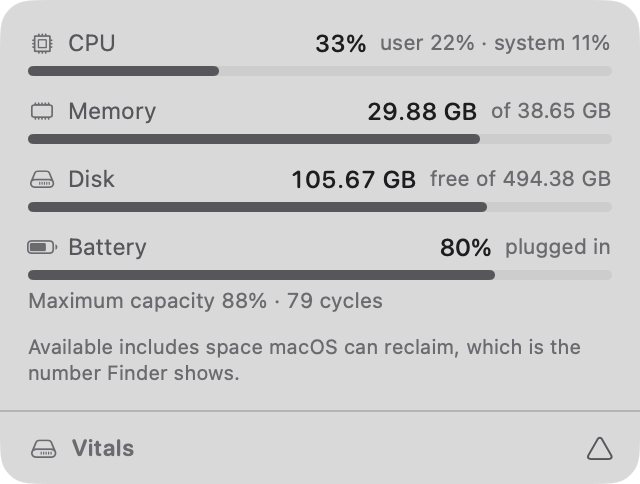
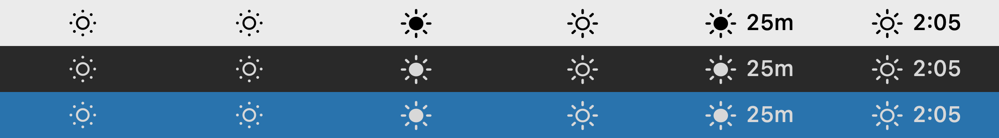

<div align="center">


# Prism

**A small toolbox in the menu bar: keep your Mac awake, and keep an eye on it.**

   

[Download](https://github.com/zchan0/Prism/releases/latest) · [Install](#install) · [Tools](#tools) · [Menu bar and panels](#menu-bar-and-panels) · [Lid sleep](#lid-sleep) · [Development](#development)

English · [简体中文](README.zh-CN.md)

<br>



</div>

Prism holds a few small tools. You can turn each tool on or off, and give each one its own menu bar icon or keep it only in the hub. Today there are three tools: **Lumos** keeps the Mac awake, **Vitals** shows how it is doing, and **Portkey** gives each of your apps a shortcut. The name comes from the portkeys of Harry Potter, objects that take you somewhere else at a touch: press an app's shortcut, and you are in that app.

## Tools

<p align="center">
  
  
</p>

### Lumos

**One click, no sleep.** Pick 30 minutes, 1 hour, 2 hours, or until you stop it, which is the default. A length picked while the Mac may sleep starts the session at once, so it is always one click. A kernel power assertion holds the Mac awake. The assertion goes away on its own if the app crashes, so nothing can leave the Mac stuck awake.

**Choose what stays on.** Keep the screen on too, or let it turn off while the Mac keeps working.

**The lid, without the guesswork.** Turn on *Keep running with the lid closed*, and Prism installs a tiny root helper once, with one administrator prompt. After that the switch is instant and asks for no password, and your normal sleep setting comes back when the session ends. See [Lid sleep](#lid-sleep).

**Battery guard.** On battery, the session ends itself at the percentage you choose, 20% by default, and tells you why. While the Mac runs on battery, the panel shows that percentage under the lengths.

**Notifications** when the time is up or the battery ends the session, and the time left in the menu bar if you want it.

### Vitals

**CPU, memory, disk and battery in one place.** The panel shows every reading with a bar:

- CPU: the average load since the last refresh, split into user and system time.
- Memory: used memory (active, wired and compressed), of the total.
- Disk: available space, with the space macOS can reclaim, the same number Finder shows.
- Battery: the charge and the power source, plus the maximum capacity and the cycle count.

**An icon for each reading you pick.** Turn on the readings you want in the menu bar. Each one gets its own icon, so you can ⌘-drag each one to its own place. Disk is on by default, and at least one stays on. Choose whether the numbers sit next to the icons. Every reading refreshes every 20 seconds and whenever the panel opens.

### Portkey

**One shortcut for each app.** Add the apps you use most, and record a shortcut for each one. Press it to bring the app to the front. If the app is not running, Portkey opens it. If the app is in front already, the same shortcut hides it.

**Record the keys you want.** Click *Edit…* on the Portkey tab or in its panel to open the Portkey window. Click an app's shortcut field and press the keys, such as ⌥⇧C or ⌃⌘F5. A shortcut needs ⌘, ⌃ or ⌥. Press Esc to stop recording, or Delete to clear the shortcut. A shortcut belongs to one app at a time: if another app has it already, or macOS refuses it, the window says so under the app, and the app keeps its old shortcut.

**Add apps from anywhere.** The + button at the top of the window lists the apps that are open and the apps in the Dock, and *Other…* picks any app in Applications. A new app has no shortcut until you record one. Portkey has no menu bar icon by default, and its shortcuts work without one. To give it an icon, turn on *Show in the menu bar*.

**A shortcut stays on its key.** Portkey remembers the key you pressed, not the letter on it. If you switch to another keyboard layout later, the shortcut stays on the same key and keeps the name it had when you recorded it.

**No permission needed.** Portkey uses the system's hot key API, `RegisterEventHotKey`, so it needs no Accessibility permission. Recording reads only the keys you type into the Portkey window.

## Menu bar and panels



Every icon is an SF Symbol template with an optional number in monospaced digits, so the menu bar tints it like the system's own icons. Lumos shows a wand, `wand.and.stars`: a bare wand while the Mac may sleep, and the wand with its stars while it is kept awake. Each Vitals icon shows the symbol of its reading: `cpu`, `memorychip`, `internaldrive`, or a battery that empties with the charge.

Prism has no icon of its own. A tool's icon appears when its *Show in the menu bar* switch is on. When no tool is in the menu bar, a small Prism icon (`triangle`) appears instead, so the hub stays reachable.

- **Click a tool's icon** to open its quick panel: the tool's controls and nothing else. The button at its bottom right opens the hub on that tool's tab.
- **Right-click a tool's icon** for *Open Prism* and *Quit Prism*.
- **Click the Prism icon**, when it shows, to open or close the hub.

The hub has one tab for each tool and a gear tab for Prism itself. A tool's tab starts with two switches, *Turned on* and *Show in the menu bar*. Below them are the same controls as in the quick panel, then the tool's settings. A tool that is turned off stops all its work and keeps its settings. The gear tab holds *Open at login*, the version and *Quit Prism*.

Only one panel is open at a time, and a click anywhere else closes it. Neither panel takes focus, so a click on it does not interrupt your typing.

## Install

1. Download `Prism-<version>.zip` from [Releases](https://github.com/zchan0/Prism/releases/latest), unzip it, and drag `Prism.app` into Applications.
2. Open the app. macOS says it cannot verify the developer, because Prism is not notarized by Apple: click Done.
3. Open System Settings → Privacy & Security. Near the bottom, find Prism, click Open Anyway, and confirm. After that, the app opens normally.

Instead of steps 2 and 3, you can run `xattr -dr com.apple.quarantine /Applications/Prism.app` once.

To update, quit Prism and replace `Prism.app` with the new one. If macOS blocks the new version, repeat steps 2 and 3.

Prism needs macOS 14 or later, on Apple silicon or Intel.

To build it yourself instead, run `scripts/package.sh --install` in a clone of this repository. It builds a universal release app, signs it ad hoc, and copies it to `/Applications/Prism.app`.

## Lid sleep

A closed lid sleeps a Mac no matter what power assertions it holds. The only way around it is `pmset -a disablesleep 1`, which needs root and stays in effect until it is set back. A crashed app would leave your Mac unable to sleep.

So the first time you turn the switch on, Prism asks for an administrator password and installs one small helper:

- `/Library/PrivilegedHelperTools/io.github.zchan0.prism.LumosLid.sh` turns `disablesleep` on while Prism holds a flag file open, and off otherwise.
- `/Library/LaunchDaemons/io.github.zchan0.prism.LumosLid.plist` runs that script at boot, every minute, and whenever the flag changes.

The helper does not look for Prism by name. It asks the kernel whether any process still holds the flag open, and the kernel closes the file however Prism exits, crash included. So a crashed Prism gets its normal sleep setting back within a minute.

The app never runs as root. It asks for the password again only when a new version changes the helper. To uninstall the helper, run:

```sh
sudo launchctl bootout system/io.github.zchan0.prism.LumosLid
sudo rm -f /Library/PrivilegedHelperTools/io.github.zchan0.prism.LumosLid.sh \
  /Library/LaunchDaemons/io.github.zchan0.prism.LumosLid.plist
sudo rm -rf /var/tmp/io.github.zchan0.prism.LumosLid
sudo pmset -a disablesleep 0
```

## Development

```sh
swift build                    # build
swift test                     # unit tests (Swift Testing)
scripts/package.sh             # .build/app/Prism.app, universal and signed ad hoc
scripts/readme-assets.sh       # regenerate docs/images
scripts/dist.sh <version>      # test, package and zip into .build/dist, as a release does
scripts/release.sh <version>   # push the tag that publishes a release
```

Prism is a SwiftPM package. AppKit draws the status items and the panels, and SwiftUI draws everything inside them.

| Module | What it holds |
| --- | --- |
| `PrismKit` | The shell's parts: the `Tool` protocol, status items, the floating panel, the menu bar glyph, shared rows and switches, per-tool settings. |
| `LumosTool` | The session engine and its power assertion, the lid helper, the battery guard, notifications. |
| `VitalsTool` | The CPU, memory, disk and battery readings. |
| `PortkeyTool` | The apps and their shortcuts, and the switch to an app: bring it to the front, open it, or hide it. |
| `Prism` | The app: it registers the tools and owns the menu bar items, the hub and the quick panel. |

A tool depends only on `PrismKit`, never on another tool. To add one, write a module with a type that conforms to `Tool`, and add one line to `AppDelegate.registrations()`.

Debug builds read a few environment variables, which is how `docs/images` is made:

| Variable | What it does |
| --- | --- |
| `PRISM_CAPTURE=<dir>` | Screenshots every hub tab and every quick panel into the folder, then quits. |
| `PRISM_STATUS_CAPTURE=<file>` | Draws every menu bar icon on a light, a dark and a blue menu bar, then quits. |
| `PRISM_START_LUMOS=1` | Starts a 30 minute Lumos session at launch. |
| `PRISM_APPEARANCE=light` or `dark` | Forces the appearance. |
| `PRISM_DUMP=1` | Prints each tool's summary, then quits. |
| `PRISM_PORTKEY_SWITCH=<bundle id>` | Switches to that app 3 seconds after launch, as a Portkey shortcut does. |
| `PRISM_SHOW_PANEL=<name>` | Opens one panel at launch and leaves it open. The name is a `PRISM_CAPTURE` file name without `.png`, such as `hub-portkey` or `quick-portkey`. |
| `PRISM_PORTKEY_WINDOW=1` | Opens the Portkey window at launch. |

### Releasing

1. Add a `## [X.Y.Z] - YYYY-MM-DD` section to `CHANGELOG.md`, and its link at the bottom. Commit it and push `main`.
2. Run `scripts/release.sh X.Y.Z`. It stops unless `main` is clean and pushed, the changelog has the section, and the tag `vX.Y.Z` is new. Then it tries the release locally with `scripts/dist.sh` and pushes the tag.
3. The tag starts the Release workflow in `.github/workflows/release.yml`. On a macOS 26 runner, the workflow tests and builds Prism, then publishes the zip, its SHA-256 and the changelog section as a GitHub release. `release.sh` waits for it and prints the link.

## Notes

- Without a battery, Vitals leaves the battery reading out, and the battery guard does nothing.
- The app follows the system language, English or Chinese. To pick a language for Prism only, use System Settings → General → Language & Region → Applications.

## License

[MIT](LICENSE)
