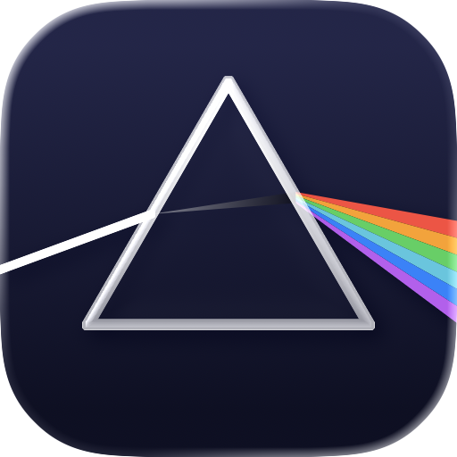
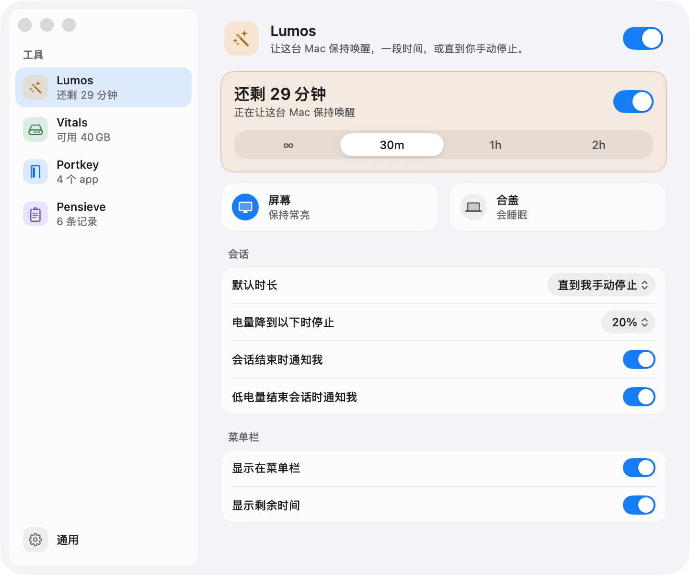
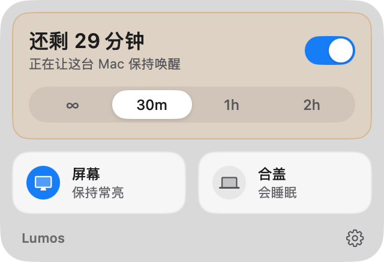
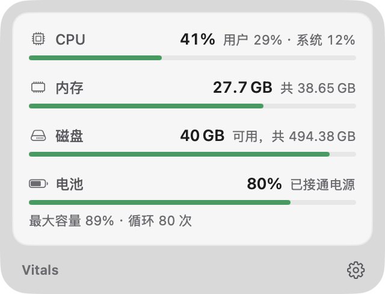
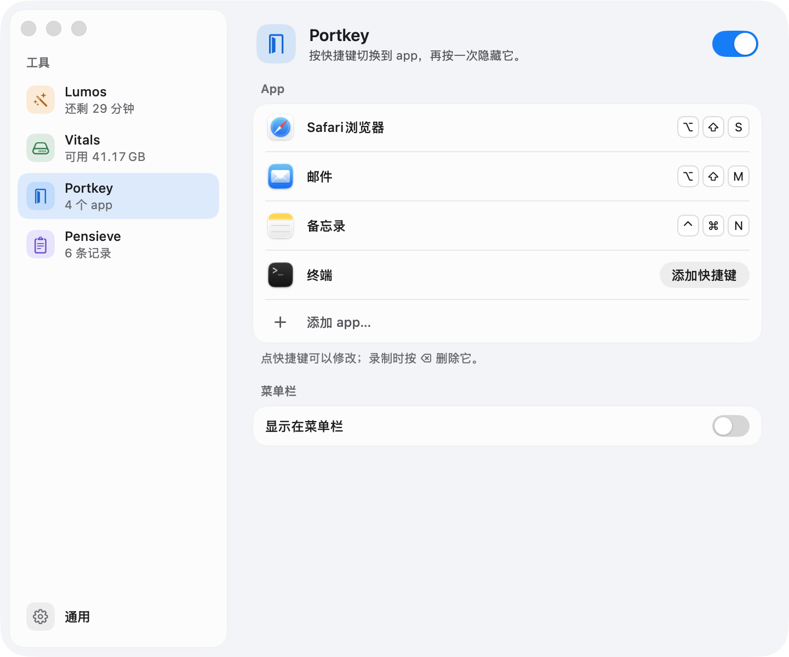
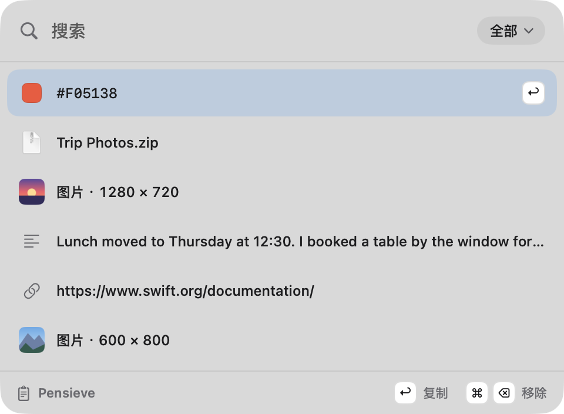
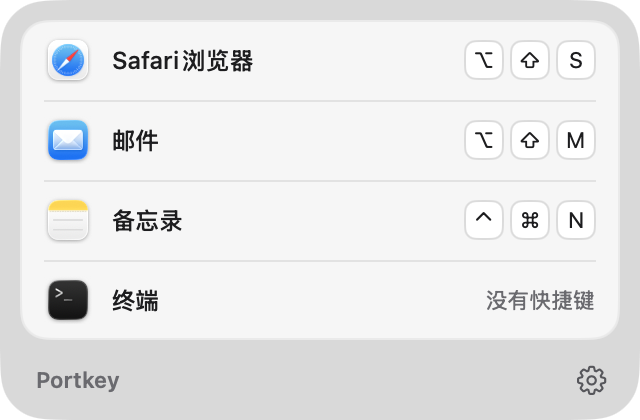
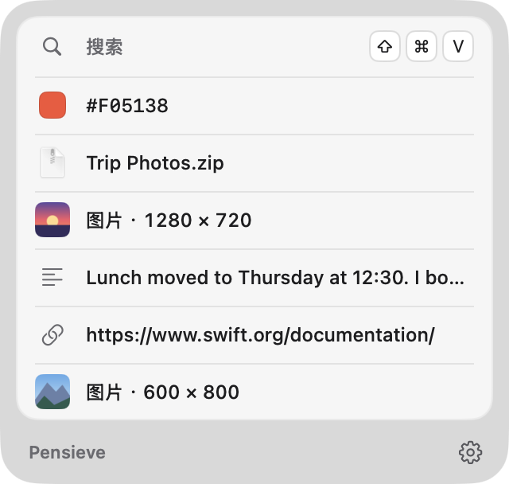

<div align="center">



# Prism

**菜单栏里的小工具箱：让 Mac 保持唤醒，也随时看看它的状态。**

   

[下载](https://github.com/zchan0/Prism/releases/latest) · [安装](#安装) · [工具](#工具) · [菜单栏和面板](#菜单栏和面板) · [合盖保持运行](#合盖保持运行) · [开发](#开发)

[English](README.md) · 简体中文

<br>



</div>

Prism 装着几个小工具。每个工具都能单独开启或关闭，也能单独决定要不要在菜单栏显示自己的图标，不显示时只在 Prism 窗口里出现。目前有四个工具：**Lumos** 让 Mac 保持唤醒，**Vitals** 显示 Mac 的状态，**Portkey** 给常用的 app 各配一个快捷键，**Pensieve** 记下你复制过的内容。Portkey 取自哈利波特里的门钥匙，碰一下就把人送到别处：按一个快捷键，直接到某个 app。Pensieve 取自同一套书里的冥想盆，用来存放记忆、随时回看。

## 工具

<p align="center">
  
  
</p>

### Lumos

**一点就醒。** 打开 Lumos 卡片上的开关，就按默认时长（「直到我手动停止」）保持唤醒。也可以点下面的 ∞、30m、1h、2h：点一个时长会立刻开始，或者让正在进行的会话按这个时长重新计时，所以永远只要点一次。保持唤醒期间卡片变成琥珀色，并显示倒计时。保持唤醒靠的是内核电源断言。app 崩溃时断言会自动消失，Mac 不会因此一直睡不了。

**屏幕由你决定。** 点「屏幕」，可以连屏幕一起常亮，也可以让屏幕熄灭、Mac 继续干活。

**合盖也能继续跑。** 点「合盖」，让 Mac 合上盖子也继续运行。Prism 会要一次管理员密码，安装一个很小的 root 助手。之后切换都是即时的、不再问密码，会话结束时你原来的睡眠设置会自动恢复。详见[合盖保持运行](#合盖保持运行)。

**低电量保护。** 用电池时，电量降到你设定的百分比（默认 20%），会话会自动结束并告诉你原因。用电池期间，「屏幕」和「合盖」下面会多一张卡片写明这一点：「电量降到 20% 时停止」。出错时（比如合盖设置没有生效），错误也显示在这张卡片里。

**通知**：时间到了、或者低电量结束了会话时都会通知你。还可以在菜单栏显示剩余时间。默认时长、停止的电量和通知都在 Prism 窗口的 Lumos 页里设置。

### Vitals

**CPU、内存、磁盘、电池放在一处。** 面板里每项读数都带一条读数条：

- CPU：上次刷新以来的平均占用率，分成用户和系统两部分。
- 内存：已用内存（活跃、联动和压缩三部分之和），以及总量。
- 磁盘：可用空间，包含 macOS 可回收的空间，和「访达」显示的数字一致。
- 电池：电量和供电来源，以及最大容量和循环次数。

**每项读数一个图标。** 打开想放进菜单栏的读数，每项各有一个图标，可以各自按住 ⌘ 拖到想要的位置。默认只开磁盘，至少保留一项。可以选择要不要在图标旁边显示数字。所有读数每 20 秒刷新一次，打开面板时也会刷新。

### Portkey

<p align="center">
  
</p>

**每个 app 一个快捷键。** 把常用的 app 加进来，给每个 app 录一个快捷键。按下快捷键，这个 app 就切到最前面。app 没在运行时，Portkey 会打开它；app 已经在最前面时，同一个快捷键会把它隐藏。

**想用什么键就录什么键。** 在 Prism 窗口的 Portkey 页里，点一个 app 的快捷键或「添加快捷键」，再按下想要的组合，比如 ⌥⇧C 或 ⌃⌘F5。快捷键要包含 ⌘、⌃ 或 ⌥。录制时按 Esc 取消，按 Delete 清除这个 app 的快捷键。一个快捷键同一时间只属于一个 app：别的 app 已经在用，或者 macOS 不接受时，页面会在这个 app 下面提示，原来的快捷键保持不变。

**面板里也能切换。** Portkey 的面板列出每个 app 和它的快捷键，点一个就和按它的快捷键效果一样。

**从哪里都能添加。** 列表最后的「添加 app…」列出现在打开着的 app 和程序坞里的 app，「其他…」可以从「应用程序」文件夹里挑任意 app。鼠标移到一个 app 上可以移除它。新加的 app 没有快捷键，录了才有。Portkey 默认不在菜单栏显示图标，没有图标快捷键也照样能用。想要图标的话，打开「显示在菜单栏」。

**快捷键跟着按键走。** Portkey 记的是你按下的那个键，不是键帽上的字母。之后换成别的键盘布局，快捷键还在同一个键上，名字也保持录制时的样子。

**不需要权限。** Portkey 用的是系统的热键接口 `RegisterEventHotKey`，不需要辅助功能权限。录制时只读取在 Prism 窗口里按下的键。

### Pensieve

<p align="center">
  
</p>

**复制过的东西都在一个列表里。** Pensieve 记下你最近复制的 200 条内容：文字、图片、文件和颜色。同样的内容再复制一次，它会移到最上面，不会重复出现。Pensieve 页里的「保留」可以改成 50 到 1000 条；调小后，最旧的记录会马上删掉。

**旧记录会自己清掉。** 一条记录在你最后一次复制它、或从列表里选中它的一个月后删除。Pensieve 页里的「自动清理」可以改成 1 天、1 周、3 个月，或者不清理。Pensieve 在启动时和之后每小时检查一次。

**在任何 app 里都能打开。** 按 ⇧⌘V，或者在 Pensieve 的面板里点「搜索」。列表出现在鼠标所在屏幕的中央，你正在用的 app 仍然在前台。直接打字就能搜索文字、文件名和颜色值。搜索框右边的筛选可以只看文字、链接、图片或文件，Tab 和 ⇧Tab 在几种筛选之间切换，每次打开列表都从「全部」开始。「文字」里也包括颜色和链接。按 ↑ ↓ 选中一条，按 Return 把它放回剪贴板，再按 ⌘V 粘贴。Pensieve 不会替你粘贴。按 ⌘⌫ 移除一条，按 Esc 关闭列表，按 ⌘, 打开 Prism 窗口的 Pensieve 页。

**图片可以放大看。** 选中一张图片时，列表旁边会出现它的大图和像素尺寸。在面板里，把鼠标在图片上停一下也会出现。

**也可以在面板里挑。** Pensieve 的面板显示最近 10 条记录，点一条就把它放回剪贴板，面板提示「已复制」后自动关闭。

**快捷键可以自己录。** 在 Prism 窗口的 Pensieve 页里点「快捷键」旁边的键帽，按下想要的组合，和 Portkey 页里一样。快捷键要包含 ⌘、⌃ 或 ⌥。录制时按 Delete 会清除快捷键，之后只能从面板打开列表。

**记什么，不记什么。** Pensieve 记纯文本、富文本、HTML、PNG 和 TIFF 图片、文件和颜色，放回剪贴板时全部原样放回，所以粘贴出来格式不变。app 标记为私密的内容（比如密码管理器里的密码）、只在剪贴板上停留片刻的内容、app 自动放上去的内容都不记，超过 20 MB 的也不记。Pensieve 页里的「暂停记录」打开期间，什么都不记，面板上会出现「继续记录」。

**有些 app 里复制的不记。** 在 Pensieve 页的「不记录这些 app」里列出不想记录的 app，按复制时最前面的 app 判断。「密码」和「钥匙串访问」默认就在列表里，直到你改动它；添加 app 的方式和 Portkey 页一样，可以从已打开的、程序坞里的或任意 app 里选。

**历史只存在这台 Mac 上。** Pensieve 把历史保存在 `~/Library/Application Support/Prism/Pensieve/`，这个文件夹只有你的用户能打开。文件没有加密。在 Pensieve 页点「清空历史记录」旁边的「清空…」会把它们全部删掉。

**不需要权限。** 任何 app 都能读取剪贴板，快捷键和 Portkey 一样用 `RegisterEventHotKey`。Pensieve 从不替你打字或粘贴，所以不需要辅助功能权限。

## 菜单栏和面板


所有图标都是 SF Symbol 模板图，可以在右边跟一段等宽数字，所以菜单栏会像给系统自带图标着色一样给它着色。Lumos 显示一根魔杖 `wand.and.stars`：Mac 可以睡眠时只有魔杖，保持唤醒时魔杖旁出现星星。Vitals 的每个图标显示它那项读数的符号：`cpu`、`memorychip`、`internaldrive`，或者一个随电量变空的电池。

Prism 没有自己的常驻图标。工具的「显示在菜单栏」开关打开时，它的图标才出现。所有工具都不在菜单栏时，会出现一个 Prism 小图标（`triangle`），保证随时能打开 Prism 窗口。

<p align="center">
  
  
</p>

- **左键点工具图标**，打开它的面板，里面只有这一个工具。最下面是工具名和齿轮，点齿轮或在面板打开时按 ⌘,，会打开 Prism 窗口里这个工具的页面。
- **右键点工具图标**，菜单里有「Prism 设置…」和「退出 Prism」，「Prism 设置…」会打开 Prism 窗口里这个工具的页面。
- **点 Prism 小图标**（出现时），打开 Prism 窗口，停在上次看的页面。
- **Prism 运行时再打开它一次**（从「访达」、聚焦搜索或启动台），也会打开 Prism 窗口。第一次运行 Prism 时，窗口会自己打开。

点面板外任何地方都会把面板关掉。面板不抢焦点，点它不会打断你正在打的字。

Prism 窗口就是完整的工具箱。左边列出全部工具，每个工具写着它现在的状态，最下面是「通用」。工具页面最上面是它的开关，这是开启或关闭工具的唯一位置。关闭的工具会停止所有工作，设置会保留。开关下面依次是这个工具的控件（Lumos 和 Vitals 有）、它的设置，最后是「菜单栏」卡片，里面有「显示在菜单栏」和这个工具自己的菜单栏设置，比如 Vitals 要在菜单栏放哪些读数。「通用」里有「外观」（跟随系统、浅色或深色）、「登录时打开」和「退出 Prism」，下面是「关于」：版本号和更新，以及 GitHub 和更新日志的链接。⌘W 关闭窗口。

## 安装

1. 从 [Releases](https://github.com/zchan0/Prism/releases/latest) 下载 `Prism-<版本号>.zip`，解压后把 `Prism.app` 拖进「应用程序」。
2. 打开 app。Prism 没有经过 Apple 公证，macOS 会提示无法验证开发者：点「完成」。
3. 打开「系统设置 → 隐私与安全性」，在靠下的位置找到 Prism，点「仍要打开」并确认。之后就能正常打开了。

也可以跳过第 2、3 步，改为运行一次 `xattr -dr com.apple.quarantine /Applications/Prism.app`。

Prism 会自己更新。它默认每天向 GitHub 查一次新版本，下载后在 Prism 空闲时安装，然后重新打开。在 Prism 窗口的「通用 → 关于」里可以改检查的频率，或者关掉自动安装。从这个功能上线之前的版本升级，仍然要手动替换一次：退出 Prism，用新的 `Prism.app` 替换旧的。如果 macOS 拦下新版本，再做一遍第 2、3 步。

这是 Prism 唯一的联网行为：只请求 `api.github.com` 和 GitHub 的下载地址，不带任何个人信息。

Prism 需要 macOS 14 或更高版本，Apple 芯片和 Intel 芯片的 Mac 都能用。

想自己构建的话，在这个仓库的 clone 里运行 `scripts/package.sh --install`。它会构建 universal 的 release 版 app，用 ad hoc 签名，然后复制到 `/Applications/Prism.app`。

## 合盖保持运行

合上盖子后，无论持有多少电源断言，Mac 都会睡。唯一的办法是 `pmset -a disablesleep 1`，它需要 root，而且会一直生效，直到被改回去。如果 app 崩了，Mac 就再也睡不了。

所以第一次点「合盖」时，Prism 会要一次管理员密码，装上一个小助手：

- `/Library/PrivilegedHelperTools/io.github.zchan0.prism.LumosLid.sh`：Prism 打开着标记文件时把 `disablesleep` 设为 1，否则设为 0。
- `/Library/LaunchDaemons/io.github.zchan0.prism.LumosLid.plist`：开机、每分钟、以及标记变化时运行上面那个脚本。

助手不按名字找 Prism，而是问内核还有没有进程打开着标记文件。Prism 不管怎么退出，包括崩溃，内核都会关闭这个文件。所以 Prism 崩溃后，最多一分钟就会恢复正常的睡眠设置。

app 本身从不以 root 运行。只有新版本改了助手时，才会再要一次密码。卸载助手运行：

```sh
sudo launchctl bootout system/io.github.zchan0.prism.LumosLid
sudo rm -f /Library/PrivilegedHelperTools/io.github.zchan0.prism.LumosLid.sh \
  /Library/LaunchDaemons/io.github.zchan0.prism.LumosLid.plist
sudo rm -rf /var/tmp/io.github.zchan0.prism.LumosLid
sudo pmset -a disablesleep 0
```

## 开发

```sh
swift build                    # 编译
swift test                     # 单元测试（Swift Testing）
scripts/package.sh             # 生成 .build/app/Prism.app，universal，ad hoc 签名
scripts/readme-assets.sh       # 重新生成 docs/images
scripts/dist.sh <version>      # 和正式发布一样测试、打包，压缩到 .build/dist
scripts/release.sh <version>   # 推送 tag，触发发布
```

Prism 是一个 SwiftPM 包。菜单栏图标、面板和窗口用 AppKit，里面的界面用 SwiftUI。

| 模块 | 内容 |
| --- | --- |
| `PrismKit` | 外壳的零件：`Tool` 协议、菜单栏图标、浮动面板和贴在窗口旁边的面板、菜单栏图标的画法、色板和所有共用零件（卡片、行、开关、分段控件、按钮、菜单、键帽、图标块、app 列表）、全局快捷键和录制快捷键的输入框、每个工具的设置存储。 |
| `LumosTool` | 会话引擎和电源断言、合盖助手、低电量保护、通知。 |
| `VitalsTool` | CPU、内存、磁盘和电池读数。 |
| `PortkeyTool` | app 列表和它们的快捷键，以及切换 app：切到最前面、打开或隐藏。 |
| `PensieveTool` | 剪贴板历史：记什么、存成哪些文件，以及历史窗口。 |
| `Prism` | app 本身：注册工具，管理菜单栏图标、各工具的面板和 Prism 窗口。 |

工具只依赖 `PrismKit`，工具之间互不依赖。加一个工具：写一个模块，里面有一个遵循 `Tool` 的类型，再在 `AppDelegate.registrations()` 里加一行。

debug 版本认几个环境变量，`docs/images` 就是这么生成的：

| 变量 | 作用 |
| --- | --- |
| `PRISM_CAPTURE=<目录>` | 把每个工具的面板（`popover-<工具>.png`）、Prism 窗口的每个页面（`window-<工具>.png`、`window-general.png`）、带电量提示和一条错误的 Lumos 面板和页面（`popover-lumos-note.png`、`window-lumos-note.png`）、Pensieve 窗口（`pensieve-window.png`）、连同背后屏幕一起截的筛选菜单（`pensieve-filter-menu.png`）、在这个菜单里选了「图片」之后的窗口（`pensieve-window-images.png`）和图片预览（`pensieve-preview.png`）截图到这个目录，然后退出。面板不占用 ⌘,，它仍然交给最前面的 app。Portkey 显示示例 app，不用你自己的列表，快捷键也不生效。Pensieve 显示示例内容，不用你的历史：不读取剪贴板，不读写历史，也不注册快捷键。 |
| `PRISM_STATUS_CAPTURE=<文件>` | 把所有菜单栏图标画在浅色、深色、蓝色三种菜单栏上，然后退出。Pensieve 不读取剪贴板，Portkey 的快捷键也不生效。 |
| `PRISM_CAPTURE_GENERAL=<文件>` | 截一张 Prism 窗口停在「通用」页的图，然后退出。和 `PRISM_CAPTURE` 一样，Lumos、Pensieve、Portkey 不动你的会话、历史和快捷键。 |
| `PRISM_SHOW_WHATS_NEW=1` | 配合 `PRISM_CAPTURE_GENERAL`，打开「更新内容」，改截窗口周围的屏幕。 |
| `PRISM_START_LUMOS=1` 或 `lid` | 启动时开始一个 30 分钟的 Lumos 会话。`lid` 还会打开合盖保持运行，前提是这个版本带的小助手已经装好；它从不要密码。 |
| `PRISM_UPDATE=1` | 让 debug 版本也能自己更新：启动时检查一次，之后按设定的频率检查。 |
| `PRISM_UPDATE_FEED=<url>` | 从这个地址读最新版本，不找 GitHub，比如本机一个字段和 GitHub 一样的 `latest.json`。 |
| `PRISM_UPDATE_INSTALL_NOW=<秒>` | 下载好的更新最早在启动后这么多秒安装，和点「安装并重新打开」一样，Lumos 保持唤醒时也装。 |
| `PRISM_UPDATE_PHASE=<名字>` | 在「通用」页显示一个假的更新状态，不检查、不下载、不保存任何东西：`idle`、`never`、`unchecked`、`checking`、`available`、`downloading`、`ready`、`readyBlocked`、`readyManual`、`installing`、`updated`、`checkFailed`、`downloadFailed`、`verifyFailed`、`installFailed`、`cannotInstall` 或 `unavailable`。 |
| `PRISM_APPEARANCE=light` 或 `dark` | 强制外观，优先于「通用」里选的外观。 |
| `PRISM_DUMP=1` | 打印每个工具的摘要，然后退出。 |
| `PRISM_PORTKEY_SWITCH=<bundle id>` | 启动 3 秒后切到这个 app，和按 Portkey 快捷键的效果一样。 |

### 发布

1. 在 `CHANGELOG.md` 里加一节 `## [X.Y.Z] - YYYY-MM-DD`，并在文末加上它的链接。提交并推送 `main`。
2. 运行 `scripts/release.sh X.Y.Z`。`main` 有未提交的改动或没推送、changelog 缺这一节、tag `vX.Y.Z` 已存在时，它都会停下。检查通过后，它先用 `scripts/dist.sh` 在本地试一遍，再推送 tag。
3. tag 会触发 `.github/workflows/release.yml` 里的 Release workflow。它在 macOS 26 runner 上测试、构建 Prism，然后把 zip、它的 SHA-256 和这一版的 changelog 发布成 GitHub Release。`release.sh` 会等它跑完，并打印 Release 链接。

## 说明

- 没有电池的机器上，Vitals 不显示电池读数，低电量保护也不起作用。
- 界面跟随系统语言，支持中文和英文。如果只想给 Prism 换语言，去「系统设置 → 通用 → 语言与地区 → 应用程序」。

## 许可

[MIT](LICENSE)
