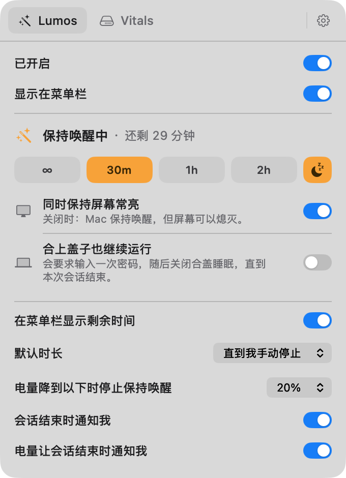
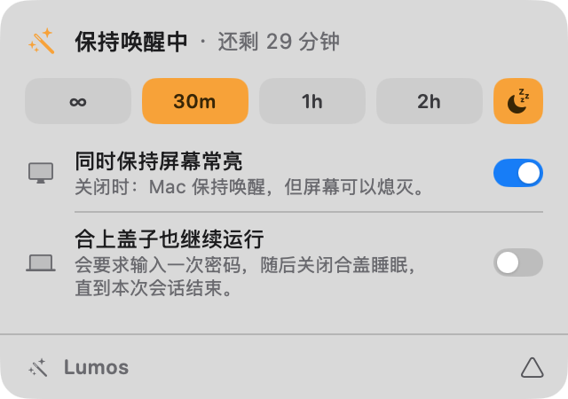
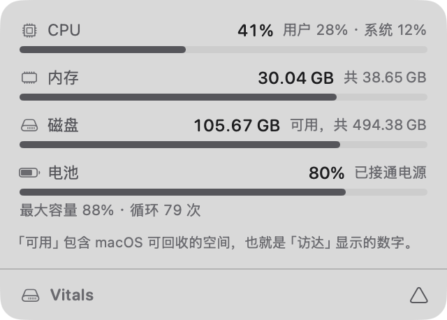

<div align="center">


# Prism

**菜单栏里的小工具箱：让 Mac 保持唤醒，也随时看看它的状态。**

   

[下载](https://github.com/zchan0/Prism/releases/latest) · [安装](#安装) · [工具](#工具) · [菜单栏和面板](#菜单栏和面板) · [合盖保持运行](#合盖保持运行) · [开发](#开发)

[English](README.md) · 简体中文

<br>



</div>

Prism 装着几个小工具。每个工具都能单独开启或关闭，也能单独决定要不要在菜单栏显示自己的图标，不显示时只在主面板里出现。目前有三个工具：**Lumos** 让 Mac 保持唤醒，**Vitals** 显示 Mac 的状态，**Portkey** 给常用的 app 各配一个快捷键。Portkey 取自哈利波特里的门钥匙，碰一下就把人送到别处：按一个快捷键，直接到某个 app。

## 工具

<p align="center">
  
  
</p>

### Lumos

**一点就醒。** 可以选 30 分钟、1 小时、2 小时，或者「直到我手动停止」（默认）。Mac 可以睡眠时，点一个时长就会直接开始，所以永远只要点一次。保持唤醒靠的是内核电源断言。app 崩溃时断言会自动消失，Mac 不会因此一直睡不了。

**屏幕由你决定。** 可以连屏幕一起常亮，也可以让屏幕熄灭、Mac 继续干活。

**合盖也能继续跑。** 打开「合上盖子也继续运行」，Prism 会要一次管理员密码，安装一个很小的 root 助手。之后开关都是即时的、不再问密码，会话结束时你原来的睡眠设置会自动恢复。详见[合盖保持运行](#合盖保持运行)。

**低电量保护。** 用电池时，电量降到你设定的百分比（默认 20%），会话会自动结束并告诉你原因。用电池期间，面板会在时长按钮下面显示这个百分比。

**通知**：时间到了、或者低电量结束了会话时都会通知你。还可以在菜单栏显示剩余时间。

### Vitals

**CPU、内存、磁盘、电池放在一处。** 面板里每项读数都带一条读数条：

- CPU：上次刷新以来的平均占用率，分成用户和系统两部分。
- 内存：已用内存（活跃、联动和压缩三部分之和），以及总量。
- 磁盘：可用空间，包含 macOS 可回收的空间，和「访达」显示的数字一致。
- 电池：电量和供电来源，以及最大容量和循环次数。

**每项读数一个图标。** 打开想放进菜单栏的读数，每项各有一个图标，可以各自按住 ⌘ 拖到想要的位置。默认只开磁盘，至少保留一项。可以选择要不要在图标旁边显示数字。所有读数每 20 秒刷新一次，打开面板时也会刷新。

### Portkey

**每个 app 一个快捷键。** 把常用的 app 加进来，给每个 app 录一个快捷键。按下快捷键，这个 app 就切到最前面。app 没在运行时，Portkey 会打开它；app 已经在最前面时，同一个快捷键会把它隐藏。

**想用什么键就录什么键。** 在 Portkey 页或它的面板里点「编辑…」，打开 Portkey 窗口。点一个 app 的快捷键框，再按下想要的组合，比如 ⌥⇧C 或 ⌃⌘F5。快捷键要包含 ⌘、⌃ 或 ⌥。录制时按 Esc 取消，按 Delete 清除这个 app 的快捷键。一个快捷键同一时间只属于一个 app：别的 app 已经在用，或者 macOS 不接受时，窗口会在这个 app 下面提示，原来的快捷键保持不变。

**从哪里都能添加。** 窗口顶部的 + 按钮列出现在打开着的 app 和程序坞里的 app，「其他…」可以从「应用程序」文件夹里挑任意 app。新加的 app 没有快捷键，录了才有。Portkey 默认不在菜单栏显示图标，没有图标快捷键也照样能用。想要图标的话，打开「显示在菜单栏」。

**快捷键跟着按键走。** Portkey 记的是你按下的那个键，不是键帽上的字母。之后换成别的键盘布局，快捷键还在同一个键上，名字也保持录制时的样子。

**不需要权限。** Portkey 用的是系统的热键接口 `RegisterEventHotKey`，不需要辅助功能权限。录制时只读取在 Portkey 窗口里按下的键。

## 菜单栏和面板


所有图标都是 SF Symbol 模板图，可以在右边跟一段等宽数字，所以菜单栏会像给系统自带图标着色一样给它着色。Lumos 显示一根魔杖 `wand.and.stars`：Mac 可以睡眠时只有魔杖，保持唤醒时魔杖旁出现星星。Vitals 的每个图标显示它那项读数的符号：`cpu`、`memorychip`、`internaldrive`，或者一个随电量变空的电池。

Prism 没有自己的常驻图标。工具的「显示在菜单栏」开关打开时，它的图标才出现。所有工具都不在菜单栏时，会出现一个 Prism 小图标（`triangle`），保证随时能打开主面板。

- **左键点工具图标**，打开它的快捷面板：只有这个工具的控件。右下角的按钮会打开主面板，并停在这个工具的 tab。
- **右键点工具图标**，菜单里有「打开 Prism」和「退出 Prism」。
- **点 Prism 小图标**（出现时），打开或关闭主面板。

主面板每个工具一个 tab，最右边的齿轮 tab 是 Prism 自身的设置。工具的 tab 最上面是「已开启」和「显示在菜单栏」两个开关，下面是和快捷面板一样的控件，再下面是这个工具的设置。关闭的工具会停止所有工作，设置会保留。齿轮 tab 里有「登录时打开」、版本号和「退出 Prism」。

同一时间只会打开一个面板，点面板外任何地方都会把它关掉。两种面板都不抢焦点，点它们不会打断你正在打的字。

## 安装

1. 从 [Releases](https://github.com/zchan0/Prism/releases/latest) 下载 `Prism-<版本号>.zip`，解压后把 `Prism.app` 拖进「应用程序」。
2. 打开 app。Prism 没有经过 Apple 公证，macOS 会提示无法验证开发者：点「完成」。
3. 打开「系统设置 → 隐私与安全性」，在靠下的位置找到 Prism，点「仍要打开」并确认。之后就能正常打开了。

也可以跳过第 2、3 步，改为运行一次 `xattr -dr com.apple.quarantine /Applications/Prism.app`。

更新时，退出 Prism，用新的 `Prism.app` 替换旧的。如果 macOS 拦下新版本，再做一遍第 2、3 步。

Prism 需要 macOS 14 或更高版本，Apple 芯片和 Intel 芯片的 Mac 都能用。

想自己构建的话，在这个仓库的 clone 里运行 `scripts/package.sh --install`。它会构建 universal 的 release 版 app，用 ad hoc 签名，然后复制到 `/Applications/Prism.app`。

## 合盖保持运行

合上盖子后，无论持有多少电源断言，Mac 都会睡。唯一的办法是 `pmset -a disablesleep 1`，它需要 root，而且会一直生效，直到被改回去。如果 app 崩了，Mac 就再也睡不了。

所以第一次打开这个开关时，Prism 会要一次管理员密码，装上一个小助手：

- `/Library/PrivilegedHelperTools/io.github.zchan0.prism.LumosLid.sh`：Prism 打开着标记文件时把 `disablesleep` 设为 1，否则设为 0。
- `/Library/LaunchDaemons/io.github.zchan0.prism.LumosLid.plist`：开机、每分钟、以及标记变化时运行上面那个脚本。

助手不按名字找 Prism，而是问内核还有没有进程打开着标记文件。Prism 不管怎么退出，包括崩溃，内核都会关闭这个文件。所以 Prism 崩溃后，最多一分钟就会恢复正常的睡眠设置。

app 本身从不以 root 运行。只有新版本改了助手时，才会再要一次密码。卸载助手运行：

```sh
sudo launchctl bootout system/io.github.zchan0.prism.LumosLid
sudo rm -f /Library/PrivilegedHelperTools/io.github.zchan0.prism.LumosLid.sh \
  /Library/LaunchDaemons/io.github.zchan0.prism.LumosLid.plist
sudo rm -rf /var/tmp/io.github.zchan0.prism.LumosLid
sudo pmset -a disablesleep 0
```

## 开发

```sh
swift build                    # 编译
swift test                     # 单元测试（Swift Testing）
scripts/package.sh             # 生成 .build/app/Prism.app，universal，ad hoc 签名
scripts/readme-assets.sh       # 重新生成 docs/images
scripts/dist.sh <version>      # 和正式发布一样测试、打包，压缩到 .build/dist
scripts/release.sh <version>   # 推送 tag，触发发布
```

Prism 是一个 SwiftPM 包。菜单栏图标和面板用 AppKit，里面的界面用 SwiftUI。

| 模块 | 内容 |
| --- | --- |
| `PrismKit` | 外壳的零件：`Tool` 协议、菜单栏图标、浮动面板、菜单栏图标的画法、共用的行和开关、每个工具的设置存储。 |
| `LumosTool` | 会话引擎和电源断言、合盖助手、低电量保护、通知。 |
| `VitalsTool` | CPU、内存、磁盘和电池读数。 |
| `PortkeyTool` | app 列表和它们的快捷键，以及切换 app：切到最前面、打开或隐藏。 |
| `Prism` | app 本身：注册工具，管理菜单栏图标、主面板和快捷面板。 |

工具只依赖 `PrismKit`，工具之间互不依赖。加一个工具：写一个模块，里面有一个遵循 `Tool` 的类型，再在 `AppDelegate.registrations()` 里加一行。

debug 版本认几个环境变量，`docs/images` 就是这么生成的：

| 变量 | 作用 |
| --- | --- |
| `PRISM_CAPTURE=<目录>` | 把主面板的每个 tab 和每个快捷面板截图到这个目录，然后退出。 |
| `PRISM_STATUS_CAPTURE=<文件>` | 把所有菜单栏图标画在浅色、深色、蓝色三种菜单栏上，然后退出。 |
| `PRISM_START_LUMOS=1` | 启动时开始一个 30 分钟的 Lumos 会话。 |
| `PRISM_APPEARANCE=light` 或 `dark` | 强制外观。 |
| `PRISM_DUMP=1` | 打印每个工具的摘要，然后退出。 |
| `PRISM_PORTKEY_SWITCH=<bundle id>` | 启动 3 秒后切到这个 app，和按 Portkey 快捷键的效果一样。 |
| `PRISM_SHOW_PANEL=<名字>` | 启动时打开一个面板，不自动关闭。名字是 `PRISM_CAPTURE` 截图的文件名去掉 `.png`，比如 `hub-portkey` 或 `quick-portkey`。 |
| `PRISM_PORTKEY_WINDOW=1` | 启动时打开 Portkey 窗口。 |

### 发布

1. 在 `CHANGELOG.md` 里加一节 `## [X.Y.Z] - YYYY-MM-DD`，并在文末加上它的链接。提交并推送 `main`。
2. 运行 `scripts/release.sh X.Y.Z`。`main` 有未提交的改动或没推送、changelog 缺这一节、tag `vX.Y.Z` 已存在时，它都会停下。检查通过后，它先用 `scripts/dist.sh` 在本地试一遍，再推送 tag。
3. tag 会触发 `.github/workflows/release.yml` 里的 Release workflow。它在 macOS 26 runner 上测试、构建 Prism，然后把 zip、它的 SHA-256 和这一版的 changelog 发布成 GitHub Release。`release.sh` 会等它跑完，并打印 Release 链接。

## 说明

- 没有电池的机器上，Vitals 不显示电池读数，低电量保护也不起作用。
- 界面跟随系统语言，支持中文和英文。如果只想给 Prism 换语言，去「系统设置 → 通用 → 语言与地区 → 应用程序」。

## 许可

[MIT](LICENSE)
