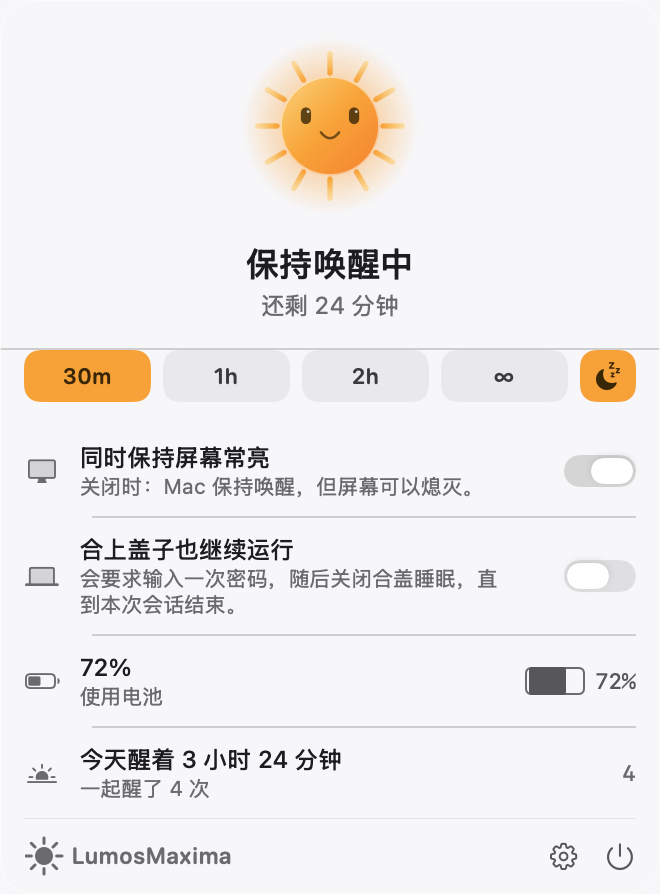
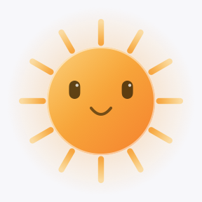
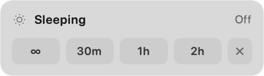
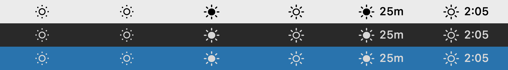

<div align="center">


# LumosMaxima

**一颗让 Mac 保持清醒的小太阳，醒着的每一小时它都会长大。**

  

[安装](#安装) · [功能](#功能) · [宠物](#宠物) · [合盖保持运行](#合盖保持运行) · [开发](#开发)

[English](README.md) · 简体中文

<br>



</div>

## 功能

**一点就醒，绝不睡过头。** 选「直到我手动停止」（默认）、30 分钟、1 小时或 2 小时——睡着时点时长也会直接开始，所以永远是一次点击。保持唤醒靠的是内核电源断言，即使 app 崩溃，断言也会随之消失，不会让你的 Mac 永远无法睡眠。

**屏幕由你决定。** 可以连屏幕一起常亮，也可以让屏幕熄灭、Mac 继续干活。

**合盖也能继续跑。** 打开「合上盖子也继续运行」，LumosMaxima 只弹一次管理员密码，安装一个很小的 root 助手。之后开关都是即时的、不再问密码；退出 app 时会自动把你的睡眠设置还原。

**低电量保护。** 用电池时，电量降到你设定的百分比（默认 20%），会话会自动结束并告诉你原因。

**值得为它保持清醒的宠物。** 能睡的时候，太阳会闭眼打盹、飘出几个 z；不能睡的时候它会醒来，呼吸、转光芒、眨眼睛。醒着的时长按自然日累计，它从「火苗」长成「余烬」「耀斑」「恒星」，最后成为「超新星」。可以拖到屏幕任何位置：单击弹出一条只含四个时长和关闭按钮的小条，双击打开设置。

**时间到了会通知你**，也可以设置登录时启动。

**闲着也省电。** 宠物是一整块 `Canvas` 按每秒 6 帧绘制，打盹时降到 3 帧；隐藏宠物后 app 只占约 0.1% 的 CPU。

**中英双语。** 界面跟随系统语言。如果只想给 LumosMaxima 换语言，去「系统设置 → 通用 → 语言与地区 → 应用程序」。

## 宠物

<p align="center">
  
  
</p>

单击宠物弹出来的小条：只有状态、四个时长和关闭。双击打开完整设置。

<p align="center"></p>

| 阶段 | 需要醒着 | 样子 |
| --- | --- | --- |
| 火苗 | 0 小时 | 很小，光芒短短的。 |
| 余烬 | 1 小时 | 更暖、稍大一点。 |
| 耀斑 | 3 小时 | 整整一圈光芒。 |
| 恒星 | 6 小时 | 深橙色，个头最大。 |
| 超新星 | 10 小时 | 最亮，光芒最长。 |

醒着的时间按自然日累计：每天从当天累计时长对应的阶段开始。设置 →「你的太阳」里能看到阶段列表，也可以重新养一只。

## 菜单栏



图标用的是 SF Symbol，菜单栏会像给系统自带图标着色一样给它着色，任何背景都清楚：能睡时是 `sun.min`，保持唤醒但屏幕可熄灭时是 `sun.max`，连屏幕也常亮时是 `sun.max.fill`。打开「在菜单栏显示剩余时间」后，倒计时会显示在旁边。

左键打开面板，右键打开同样的菜单。<kbd>⌃</kbd><kbd>⌥</kbd><kbd>⌘</kbd><kbd>L</kbd> 在任何地方都能开始或停止。

## 安装

```sh
git clone https://github.com/zchan0/LumosMaxima.git
cd LumosMaxima
scripts/package.sh --install
```

这会构建 release 版 app，有 Apple Development 证书时用它签名，然后复制到 `/Applications`。目前还没有公证过的下载版本。

## 合盖保持运行

合上盖子后，无论持有多少电源断言，Mac 都会睡。唯一的办法是 `pmset -a disablesleep 1`，它需要 root，而且会一直生效——如果 app 崩了，你的 Mac 就再也睡不着了。

所以第一次打开这个开关时，LumosMaxima 会要一次管理员密码，装上一个小助手：

- `/Library/PrivilegedHelperTools/LumosMaximaLid.sh` —— 让 `disablesleep` 和标记文件保持一致；LumosMaxima 没在运行时把它还原。
- `/Library/LaunchDaemons/io.github.zchan0.LumosMaxima.lid.plist` —— 开机、每分钟、以及标记变化时运行上面那个脚本。

app 本身从不以 root 运行，也不会问第二次密码。想卸载助手只要一条命令：

```sh
sudo launchctl bootout system/io.github.zchan0.LumosMaxima.lid
sudo rm -f /Library/PrivilegedHelperTools/LumosMaximaLid.sh \
  /Library/LaunchDaemons/io.github.zchan0.LumosMaxima.lid.plist
sudo pmset -a disablesleep 0
```

## 开发

```sh
swift build            # 编译
swift test             # 单元测试（Swift Testing）
scripts/package.sh     # 生成 .build/app/LumosMaxima.app
scripts/readme-assets.sh   # 重新生成 docs/images
```

工程结构和这个目录下其他小菜单栏 app 一致：SwiftPM 可执行 target，状态栏和窗口用 AppKit，里面的界面用 SwiftUI，再用一个可观察的 `AppModel` 管住会话和它的副作用。

| 文件 | 作用 |
| --- | --- |
| `SessionEngine.swift` | 持有电源断言、倒计时、报告会话是怎么结束的。 |
| `SleepAssertion.swift` | IOKit 断言：`PreventUserIdleSystemSleep`，需要时再加显示器那条。 |
| `LidControl.swift` | 安装助手、标记文件，以及读取 `pmset`。 |
| `Battery.swift` | 电量、充电状态和低电量规则。 |
| `SunStage.swift` | 宠物的成长阈值，纯函数、有单元测试。 |
| `PanelView.swift`、`SunPetView.swift` | 面板和宠物，全部用 SwiftUI 画。 |
| `AppDelegate.swift` | 启动、每秒的 tick、干净地退出。 |

debug 版本认几个用于截图的环境变量，`docs/images` 就是这么来的：`LUMOS_SNAPSHOT`、`LUMOS_PANEL_STATE=asleep`、`LUMOS_STATUS_SNAPSHOT`、`LUMOS_PET_SNAPSHOT`、`LUMOS_PET_STATE`、`LUMOS_APPEARANCE`、`LUMOS_AUTO_START`、`LUMOS_OPEN_PANEL`、`LUMOS_PANEL_CAPTURE`。

## 说明

- 没有电池的机器，电池那一行和低电量规则什么都不做。
- 打开「减弱动态效果」后，宠物不再呼吸、转光芒、眨眼，但表情还在。
- app 从不抢焦点：面板和宠物都是非激活窗口，点它们不会打断你正在打的字。
